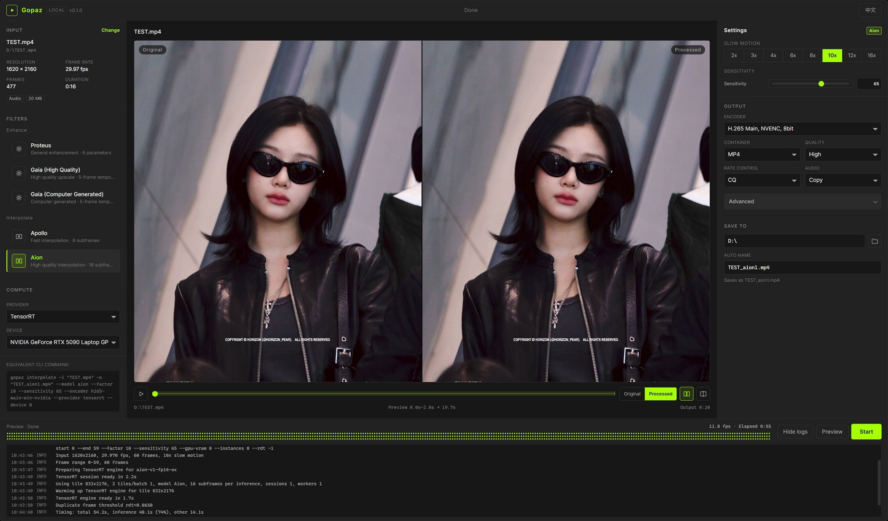

# Gopaz

用纯 Go 逆向实现 Topaz Video AI 的本地推理，支持超分、修复、慢放，带本地 Web 界面。

[English](README.md) | 中文

<p align="center">
  
</p>
<p align="center"><sub>Aion 10x 慢放，左右对比和实时日志</sub></p>

Gopaz 在 Windows 本地运行 Topaz Video AI 模型。核心是纯 Go，无 cgo、无 C 编译器、无 Python；ONNX Runtime C API 通过 `syscall` 直接调用，视频读写交给 ffmpeg 子进程。

## 功能

- **本地 Web 界面** — 导入视频、预览当前播放位置的一小段、原画与处理后左右或分割线对比、循环播放，并查看速度、剩余时间和实时日志。
- **增强** — Proteus 提供 6 个参数和逐帧自动参数估计；Gaia 和 Gaia-CG 分别面向实拍和 CG 内容。支持 1x、2x、4x。
- **插帧** — Apollo 和 Aion，支持 2x 到 16x 慢放，包含场景切换感知和重复帧替换。
- **后端** — CUDA、TensorRT、DirectML 使用 GPU，OpenVINO 支持 GPU/NPU，另有 CPU 回退。推理后端和视频编码器互相独立。
- **编码** — NVIDIA NVENC 和 Intel Quick Sync 的 H.264/H.265，以及软件 H.264、VP9、FFV1；音频支持 copy、AAC、AC3、PCM、Vorbis，慢放音频自动变速。
- **便携** — 一个可执行文件加可选的运行时和模型包。缺少的后端和模型不会显示在 UI 中，放好对应文件夹后刷新即可。
- **状态保存** — 模型、每个模型各自的参数、后端、编码器、输出选项和日志面板状态都会从 `config.json` 恢复。

## 模型

| 模型 | 类型 | 倍率或倍数 | 说明 |
|---|---|---|---|
| Proteus | 增强 | 1x / 2x / 4x | 6 个参数，支持 Auto 参数估计 |
| Gaia | 增强 | 1x / 2x / 4x | 高质量，适合实拍 |
| Gaia-CG | 增强 | 1x / 2x / 4x | 适合 CG 内容 |
| Apollo | 插帧 | 2x–16x | 每次推理最多 8 个子帧 |
| Aion | 插帧 | 2x–16x | 16 个子帧，两级推理 |

Gopaz 只实现这 5 个模型，暂不支持 Nyx、Iris、Rhea、Theia、Artemis。推理管线细节见 [ARCHITECTURE.md](ARCHITECTURE.md)。

## 下载

到 [Releases](https://github.com/zyoung11/Gopaz/releases/latest) 下载 `gopaz.exe` 和需要的资源。没有安装程序，按下面的目录放好即可使用。

| 资源 | 位置 | 用途 |
|---|---|---|
| `gopaz.exe` | Gopaz 根目录 | 必需 |
| `ffmpeg.zip` | Gopaz 根目录 | 必需 |
| `CUDA.zip` | `runtime/NVIDIA/` | CUDA、TensorRT、CPU |
| `Compute.zip` | `runtime/NVIDIA/` | CUDA / TensorRT；系统已装 CUDA Toolkit + cuDNN 时可省 |
| `TensorRT.zip` | `runtime/NVIDIA/` | TensorRT；系统已装 TensorRT 时可省 |
| `DirectML.zip` | `runtime/` | DirectML |
| `OpenVINO.zip` | `runtime/` | OpenVINO |
| `proteus.zip` | `models/` | Proteus |
| `gaia-1.zip` | `models/` | Gaia-CG |
| `gaia-2.zip` | `models/` | Gaia |
| `apollo-1.zip`、`apollo-2.zip` | `models/` | Apollo；两个包合起来覆盖全部块尺寸 |
| `aion.zip` | `models/` | Aion |

CUDA 还需要 NVIDIA 驱动。`CUDA.zip` 包含带 CUDA/TensorRT 插件的 ONNX Runtime，`Compute.zip` 包含 CUDA 数学库和 cuDNN；TensorRT、DirectML、OpenVINO 各自再加一个运行时目录。CPU 后端可以使用其中任意一套 ONNX Runtime。

解压后的目录结构：

```
Gopaz/
├─ gopaz.exe
├─ config.json              首次运行自动生成
├─ ffmpeg/
│  ├─ ffmpeg.exe
│  └─ ffprobe.exe
├─ models/
│  ├─ proteus/
│  ├─ gaia/
│  ├─ apollo/
│  └─ aion/
├─ runtime/
│  ├─ NVIDIA/
│  │  ├─ CUDA/
│  │  ├─ Compute/
│  │  └─ TensorRT/
│  ├─ DirectML/
│  └─ OpenVINO/
└─ cache/                   自动生成，可删除
```

## 快速开始

1. 新建一个空文件夹，放入 `gopaz.exe` 并解压 `ffmpeg.zip`
2. 加入运行时，例如把 `CUDA.zip` 和 `Compute.zip` 解压到 `runtime/NVIDIA/`
3. 把要用的模型包解压到 `models/`
4. 运行 `gopaz.exe`，浏览器会打开 `http://127.0.0.1:8765`

选择视频、模型和设置后开始处理。**Preview** 会从当前播放位置渲染一小段，**Logs** 查看实时日志。

## 使用

### Web 界面

```bash
gopaz
gopaz serve --port 9000 --no-open
```

界面支持原生文件和文件夹选择、每个模型的参数、编码器和音频选项、帧范围、取消任务、速度/剩余时间、实时日志以及预览和对比。一次只运行一个任务，CLI 仍然可用。

设置、每个模型的参数和日志面板状态保存在 `gopaz.exe` 旁的 `config.json`，下次启动自动恢复；重新选中某个模型时会恢复该模型上次的参数。

### 命令行

| 命令 | 用途 |
|---|---|
| `gopaz upscale` | 超分或修复视频 |
| `gopaz interpolate` | 慢放或插帧 |
| `gopaz prepare` | 把 `.tz` 模型转换成明文 `.onnx` |
| `gopaz models` | 列出已安装的模型 |
| `gopaz encoders` | 列出可用编码器 |
| `gopaz devices` | 列出 CUDA、DirectML 和 OpenVINO 设备 |
| `gopaz help` | 显示全部选项 |
| `gopaz -v` | 显示版本 |

示例：

```bash
gopaz upscale -i input.mp4 -o output.mp4 --model proteus --scale 2 --encoder h264-main-sw
gopaz interpolate -i input.mp4 -o output.mp4 --model aion --factor 4 --sensitivity 65
```

Proteus 参数是 `--deblur`、`--denoise`、`--detail`、`--dehalo`、`--sharpen`、`--fix-compression`，范围 -100 到 100；`--auto` 让参数模型逐帧自动选择，手动参数会被忽略。插帧使用 `--factor`、`--sensitivity` 和 `--rdt`。

常用选项：

| 选项 | 说明 |
|---|---|
| `--provider cuda / tensorrt / dml / openvino / cpu` | 推理后端 |
| `--device <id>` | 设备索引，或 OpenVINO 的 `GPU.0` / `GPU.1` / `NPU` / `CPU` |
| `--video-device sw / cuda / qsv` | 视频解码：软件、NVDEC 或 Quick Sync |
| `--encoder <id>` | `gopaz encoders` 中的编码器，默认自动选择 |
| `--quality`、`--rate-control`、`--bitrate`、`--qp` | 编码质量和码率控制 |
| `--start`、`--end` | 只处理指定帧范围 |
| `--ffmpeg`、`--ffprobe` | 指定工具路径 |

`gopaz help` 里还有线程、worker、显存上限、分块重叠和音频等完整选项。

输出文件名默认为 `<输入名>_<模型标签>`，例如 `_prob4`、`_ghq5`、`_gcg5`、`_apo8`、`_aion1`；重名时自动追加 `(N)`。

## 配置

首次运行会在可执行文件旁生成 `config.json`。

| 选项 | 默认值 | 说明 |
|---|---|---|
| `saveState` | `true` | 是否持久化 UI 状态 |
| `restoreVideo` | `true` | 启动时自动加载上次的视频 |
| `previewDuration` | `2` | Preview 处理的源视频秒数 |
| `port` | `8765` | Web 端口；`--port` 优先 |

`state` 保存当前模型、后端和设备、编码器、输出选项、语言、每个模型各自的参数，以及日志面板的开关。日常使用直接操作界面即可，不需要手改。

环境变量：

| 变量 | 说明 |
|---|---|
| `GOPAZ_MODEL_DIR` | 模型目录 |
| `GOPAZ_ORT_DLL` | `onnxruntime.dll` 路径 |
| `GOPAZ_CACHE_DIR` | 缓存目录；相对路径相对于当前工作目录 |
| `GOPAZ_CONFIG` | 覆盖 `config.json` 路径 |
| `GOPAZ_CUDNN_ALGO` | cuDNN 卷积算法：`exhaustive`、`heuristic`、`default` |
| `GOPAZ_DEBUG=1` | 输出诊断日志 |
| `GOPAZ_PROGRESS=json` | 以 JSON 行输出日志和进度 |

TensorRT engine 和 OpenVINO 编译结果缓存在 `cache/tensorrt/` 和 `cache/openvino/`。模型和分块尺寸首次运行可能要几分钟，之后复用缓存；删除 `cache/` 会重新构建。预览视频在 `cache/preview/`，每次启动 Web 界面时清空。

## 从源码构建

```bash
git clone https://github.com/zyoung11/Gopaz.git
cd Gopaz/gopaz
go build -ldflags="-s -w" .
go test ./...
```

前端通过 `//go:embed` 打包，不需要 Node.js 或单独的前端构建。可选的端到端测试需要 ffmpeg、模型文件和 ONNX Runtime：

```bash
GOPAZ_E2E=1 go test . -run E2E -v
```

## 已知限制

- 仅支持 Windows x64
- 全程 RGB24，尚未实现 10bit 和 YUV 输出
- Apollo 的 10/12/16 子帧复用和 Topaz 的重复帧边界是近似实现
- TensorRT 和 DirectML 强制单会话单 worker；OpenVINO 支持并发
- 实际性能取决于 GPU、驱动、运行时版本和模型尺寸

后端、分块、颜色处理、失败模式和更多限制见 [ARCHITECTURE.md](ARCHITECTURE.md)。

## 许可证

代码使用 [MIT License](LICENSE)。

Gopaz 与 Topaz Labs 没有关联。模型文件（包括 `.tz` 和用 `gopaz prepare` 转换出的 `.onnx`）归 Topaz 所有，不适用 MIT 许可证；请只在自己的机器上使用，不要分发。
